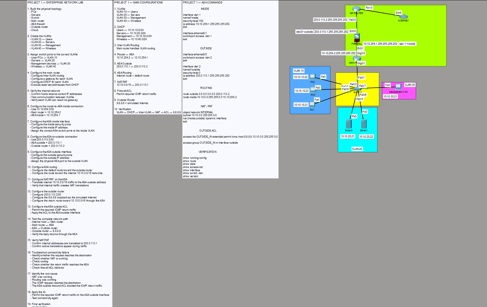
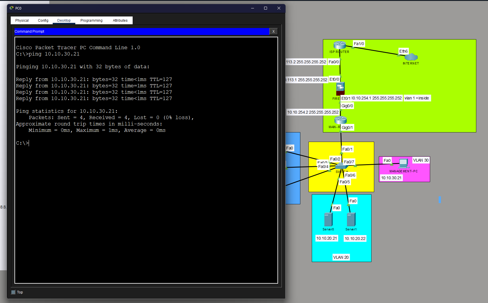
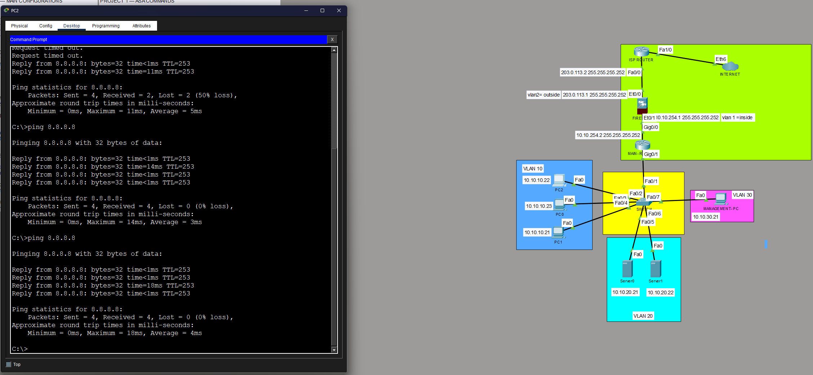

# Enterprise Network Infrastructure & Firewall

**Project 3 | Cisco Packet Tracer | Network Engineering & Security**

## 1. Project Overview

Designed and configured an enterprise network infrastructure using Cisco Packet Tracer.

The project covers VLAN segmentation, inter-VLAN routing, DHCP, Cisco ASA firewall configuration, NAT/PAT, ACLs, ISP connectivity, and simulated Internet access.

## 2. Network Architecture

| Component | Configuration |
|---|---|
| VLAN 10 | Users — 10.10.10.0/24 |
| VLAN 20 | Servers — 10.10.20.0/24 |
| VLAN 30 | Management — 10.10.30.0/24 |
| VLAN 40 | Wireless — 10.10.40.0/24 |
| Firewall | Cisco ASA |
| ISP Router | 203.0.113.2/30 |

## 3. VLANs & Inter-VLAN Routing

Configured four VLANs to separate network devices and traffic:

- VLAN 10 — Users
- VLAN 20 — Servers
- VLAN 30 — Management
- VLAN 40 — Wireless

Implemented inter-VLAN routing and DHCP configuration.

## 4. Firewall Configuration

Configured Cisco ASA firewall with inside and outside interfaces.

| Interface | IP Address |
|---|---|
| Inside | 10.10.254.1/30 |
| Outside | 203.0.113.1/30 |

Configured ISP connectivity and a default route:

`0.0.0.0/0 → 203.0.113.2`

Implemented ACLs to control network traffic.

## 5. NAT/PAT Configuration

Configured NAT/PAT on the Cisco ASA firewall.

- Internal network: `10.10.0.0/16`
- NAT/PAT through the ASA outside interface.

## 6. Connectivity Testing

Performed connectivity testing within the simulated network.

**Internet connectivity test:**

- Destination: `8.8.8.8`
- Packets received: 4/4
- Packet loss: 0%

Inter-VLAN connectivity testing was also documented.

## 7. Project Files

- [Packet Tracer Project](enterprise-network-infrastructure.pkt)
- [Project Overview & Configuration](project-overview.png)
- [Inter-VLAN Connectivity Test](inter-vlan-connectivity-test.png)
- [Internet Connectivity Test](internet-connectivity-test.png)

## 8. Technical Skills

- Cisco Packet Tracer
- VLAN Configuration
- Inter-VLAN Routing
- DHCP
- Cisco ASA Firewall
- Access Control Lists (ACLs)
- NAT/PAT
- Default Routing
- Network Segmentation
- Connectivity Testing

## 9. Project Evidence

### Network Topology & Configuration

### Inter-VLAN Connectivity

### Internet Connectivity

---

*Enterprise network design, configuration, and firewall implementation using Cisco Packet Tracer.*
